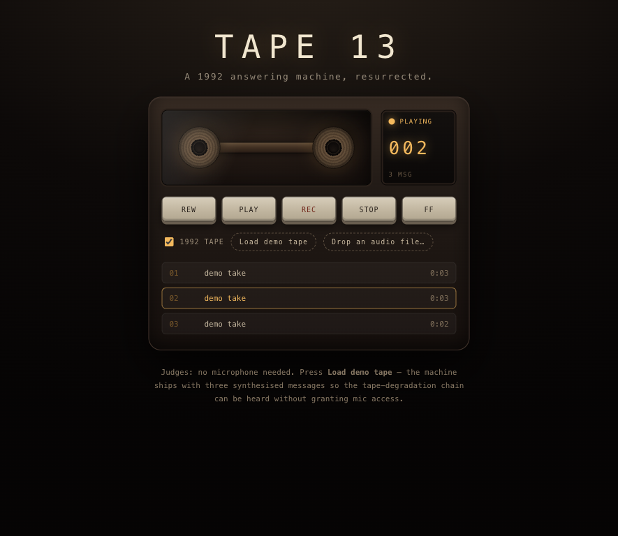

# TAPE 13

A 1992 tape answering machine, resurrected in the browser — leave a message for someone who can no
longer pick up.

<!-- SCREENSHOT: drop a 1200x750 capture of the machine here, e.g.  -->

Entry for **Kiroween 2026**, category **Resurrection**. Zero backend, zero
dependencies, zero build step.

## Run it

```bash
python3 -m http.server 8080
# then open http://localhost:8080
```

No `npm install`, no bundler, no environment variables. The page also opens from `file://`, though
IndexedDB and the microphone prefer a real origin.

## What it does

1. **Records and keeps.** REC captures up to 60 seconds from the microphone, stores the blob in
   IndexedDB (`tape13` / `messages`) and reloads it on the next visit. Nothing leaves the browser.
2. **Plays it back through 1992.** With the `1992 TAPE` switch on, every playback is run through the
   degradation chain below; flipping it off and on again replays the same message clean, for an
   honest A/B.
3. **Ships with a demo tape.** *Load demo tape* synthesises three takes in code (an arpeggio, wind,
   a telephone pulse train) — no mic permission, no third-party audio — and plays them in sequence.
4. **Has a real transport.** REW / PLAY / REC / STOP / FF, with an amber LED that reads
   `STANDBY`, `PLAYING`, `RECORDING`, `REWIND`, `FAST FWD`, and a three-digit counter (`000`).
5. **Keeps one tape.** The message log lists takes in recorded order; playing rolls on to the next
   message, REW and FF step one message at a time, and the counter follows the playhead.
6. **Takes a dropped file.** Drag any audio file onto the machine (or use *Drop an audio file…*) and
   it is imported as a new message on the tape.

## The tape chain

Built in `app.js` with plain Web Audio nodes, rebuilt per playback:

```
AudioBufferSourceNode
  -> WaveShaper        tanh saturation, oversample "2x"
  -> BiquadFilter      type "lowpass",  3200 Hz, Q 0.7
  -> BiquadFilter      type "highpass",  180 Hz
  -> destination

in parallel:
  white-noise loop -> Gain 0.014       -> destination            (hiss)
  Oscillator 0.7 Hz -> Gain 0.006      -> src.playbackRate        (wow)
  Oscillator 6.3 Hz -> Gain 0.0018     -> src.playbackRate        (flutter)
```

Wow and flutter modulate `playbackRate` rather than driving a delay node, which is what makes it
sound like a worn capstan instead of a chorus pedal. Hiss is mixed in parallel because tape noise is
a source, not a filter. `stopEverything()` stops every oscillator and noise buffer it started.

## How Kiro was used

The `.kiro/` directory at the repo root is the working record, not decoration:

| Path | What it is |
|---|---|
| `.kiro/specs/answering-machine/brief.md` | the feature brief handed to Kiro's Spec mode (requirements, acceptance criteria, non-goals) |
| `.kiro/steering/audio-dsp.md` | steering doc for the tape chain: node order, depth limits, why wow/flutter is a rate change |
| `.kiro/steering/ui-style.md` | steering doc for the skeuomorphic look: palette, light-from-above, reel motion rules |
| `.kiro/steering/product.md` | always-on product rules: no backend, degradation is the feature, demo tape is first-class |
| `.kiro/hooks/dev-checks.json` | hook that runs `node --check app.js` on every JS save, and appends a line to `DEVLOG.md` when a session ends |

The steering docs are why the CSS stays asset-free and why the DSP order survived refactors; the
hook is why no half-parsed `app.js` ever reached a browser.

## Licence

MIT — see `LICENSE`.
